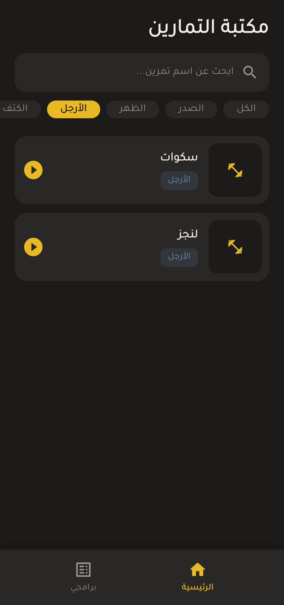
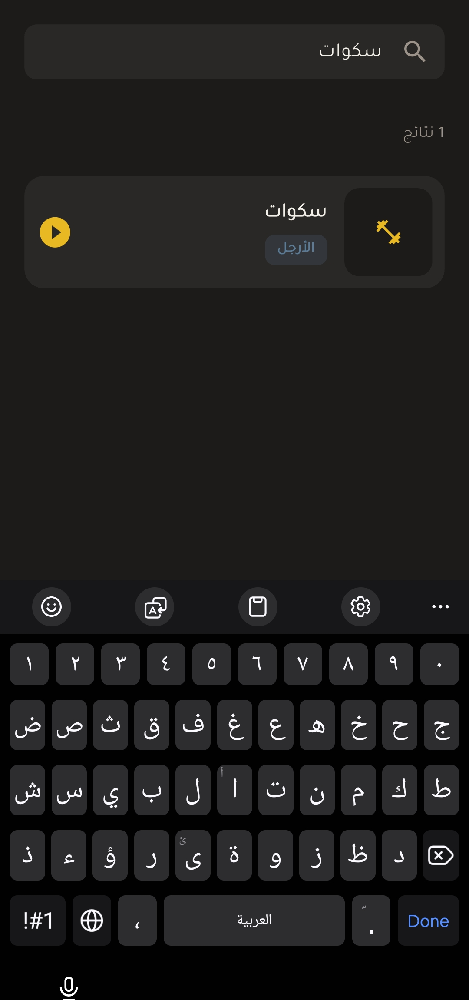
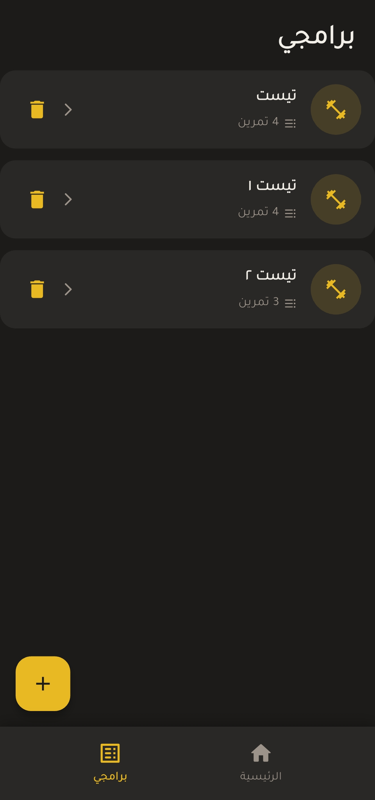
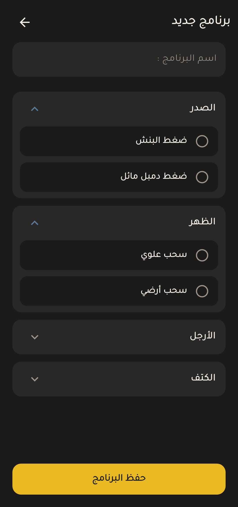
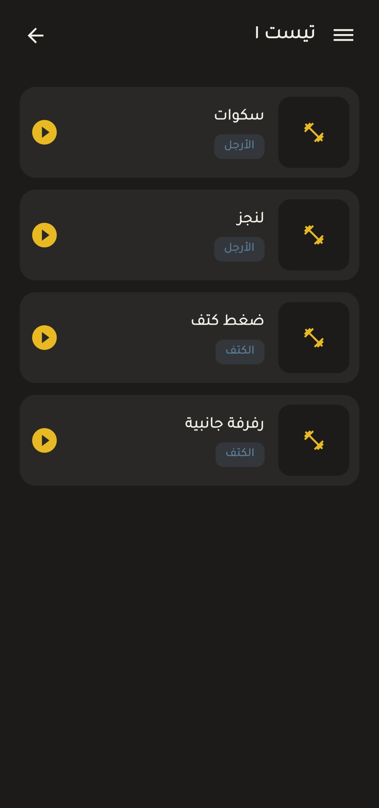
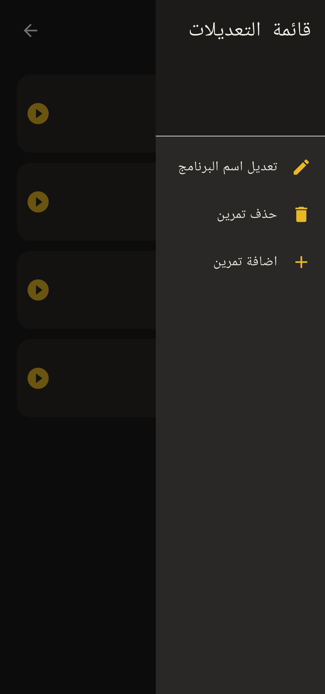

# Workout App

A Flutter app for browsing exercises, building your own workout programs, and tracking your progress over time. The interface is in Arabic (right-to-left).

## Features

- **Exercise library:** browse exercises with a thumbnail, short description and step-by-step instructions.
- **Filter by muscle group:** chest, back, legs, shoulders, arms, or all.
- **Search:** find an exercise by name.
- **Exercise details:** description, steps, and a video preview for each exercise.
- **Custom workout programs:** create a program, pick exercises grouped by muscle, rename it, add or remove exercises, or delete it.
- **Progress tracking:** log the weight and reps for each exercise, see your history, and follow your improvement on a line chart.
- **Works offline:** programs and progress are saved on the device.

## Screenshots

  

   

## Tech stack

| Area | Tools |
| --- | --- |
| Framework | Flutter, Dart |
| State management | `flutter_bloc` (Cubit) |
| Local storage | `hive`, `hive_flutter` |
| Charts | `fl_chart` |
| Video | `video_player` |
| Date formatting | `intl` |

## Project structure

```
lib/
├── cubit/    # State management (exercises, programs, progress, search)
├── model/    # Data models (exercise, workout program, progress entry)
├── view/     # App screens
├── widget/   # Reusable UI components, grouped by screen
├── theme/    # Colors
└── main.dart
```

Exercise data is loaded from a local JSON file (`assets/data/exercise.json`).

## Getting started

1. Install [Flutter](https://docs.flutter.dev/get-started/install).
2. Clone the repository:
   ```bash
   git clone https://github.com/ZAIN-Zaug/workout-app.git
   cd workout-app
   ```
3. Install the dependencies:
   ```bash
   flutter pub get
   ```
4. Run the app:
   ```bash
   flutter run
   ```

## Author

**Zain Ahmad Issa** — [GitHub](https://github.com/ZAIN-Zaug)
